# SkyADB-Pro

<p align="center">
  
</p>

SkyADB-Pro，基于 SkyADB 进行优化改进的版本，快捷高效地在 Android 设备之间进行 ADB 调试，内置丰富功能可直接使用或二次开发！

SkyADB-Pro is an optimized and improved version of SkyADB, designed for fast and efficient ADB debugging across Android devices; it comes with a rich set of built-in features ready for immediate use or further development.

---

## 功能特性 / Features

### 连接 / Connection
- **手动连接**：输入目标设备 IP 和 ADB 端口（默认 5555）。
- **无线配对**：输入配对 IP、配对端口与 6 位配对码，调用 Kadb Pairing 完成配对。
- **扫码连接（1.0.1 新增）**：扫描目标设备无线调试二维码，自动解析配对地址与配对码，一键完成配对连接，免去手动输入。
- **局域网发现**：NSD / mDNS 自动发现 `_adb._tcp.` 服务，并支持网段扫描兜底。
- **USB OTG**：识别 ADB / Fastboot 接口，授权后直连。
- **最近设备**：自动保存连接历史，一键回填。
- **连接分享**：为当前连接地址生成二维码，对方扫码即可 `adb connect`。

### 屏幕 / Screen
- **控制模式**：基于 scrcpy 的实时屏幕镜像，支持远程触控、音频转发与中文输入法。
- **观看模式**：纯观看目标设备屏幕，无控制权限干扰。
- **截图**：调用 `screencap` 拉取预览，可保存到本机。
- **虚拟遥控器**：模拟返回、主页、方向键、音量、媒体控制等常用按键，支持自定义组合键。

### 应用 / Apps
- **应用管理**：应用列表、分类筛选、搜索、启动、停止、**冻结 / 解冻**、卸载、导出，支持多选批量卸载 / 导出。
- **本机应用**：列出本机用户应用，导出并安装到目标设备。
- **安装 APK**：选择本机 APK 安装到已连接设备。
- **在线下载**：从 HTTP / HTTPS 链接下载 APK 或文件，支持进度、取消、断点续传，下载后可安装或推送。

### 文件 / Files
- **文件管理**：浏览目标设备目录、上传、下载、新建文件夹、删除文件，支持多选批量传输。
- **上传到设备（1.0.1 新增）**：将本机文件一键 Push 到目标设备指定目录，支持多选与进度展示。
- **从设备拉取（1.0.1 新增）**：将目标设备文件 Pull 到本机 Download 目录，支持多选批量拉取。
- **存储空间（1.0.1 新增）**：概览目标设备各分区存储占用情况，快速定位空间瓶颈。

### 系统 / System
- **ADB5555（1.0.1 新增）**：一键开启设备 5555 无线 ADB 常连端口并自动重连，省去逐条敲命令；若自动重连未成功会提示手动连接。
- **查看摄像头**：查看目标设备前置 / 后置摄像头画面。
- **媒体库**：浏览目标设备媒体文件。
- **系统状态**：网络、电池、存储、CPU、内存、屏幕亮度、当前应用与进程列表实时监控。
- **系统日志**：读取目标设备系统日志并支持复制。
- **Shell**：执行 Shell 命令，展示输出、错误输出与退出码，支持历史命令与常用命令收藏持久化。

### 设置 / Settings
- 默认端口、连接超时、命令超时、扫描网段。
- 镜像画质（流畅 / 均衡 / 高清 / 自定义）、摄像头画质、状态刷新间隔。
- 主题模式、语言（中文 / English）。
- 诊断日志：记录错误与异常，便于排查连接与功能异常。
- 清理最近设备。
- **版本更新**：设置页检查 GitHub Releases 最新版本，支持应用内直接下载并安装更新。
- **内存优化**：限制镜像视频解码缓冲，避免长时间镜像导致内存占用过高。

## 效果展示 / Screenshots

### 设备连接 / Device Connection

手动连接（IP + 端口）、无线配对、发现设备、USB OTG 与最近设备管理。

<p align="center">
  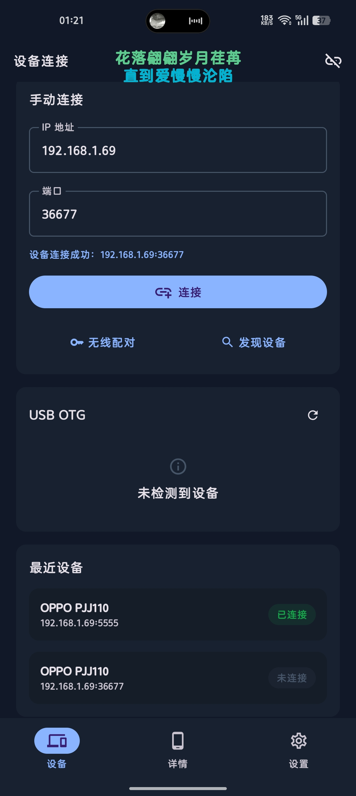
</p>

### 设备详情与功能入口 / Device & Tools

设备详情页汇集文件管理、上传到设备、从设备拉取、存储空间，以及 ADB5555、查看摄像头、媒体库、系统状态、系统日志、Shell 等快捷入口；下方展示品牌、型号、Android 版本、SDK、ABI、分辨率等系统信息。

<p align="center">
  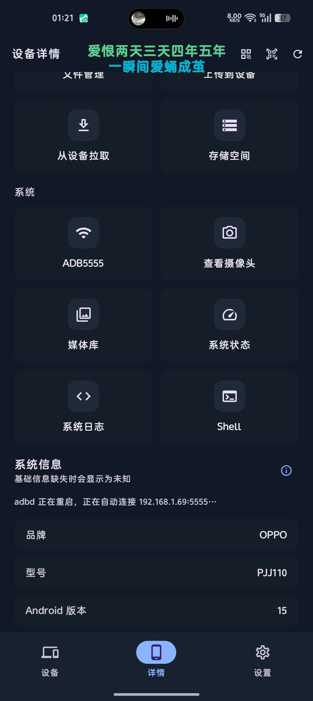
  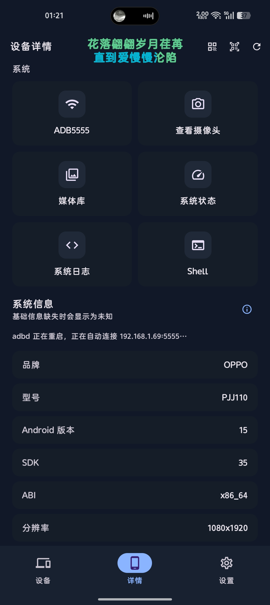
</p>

### 屏幕镜像 / Screen Mirror

控制模式实时镜像目标设备屏幕，支持远程触控与底部按键（返回 / 主页 / 最近 / 电源 / 音量 / 音频 / 隐私屏）；观看模式仅查看画面。

<p align="center">
  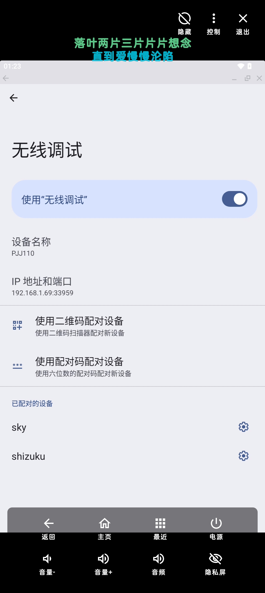
  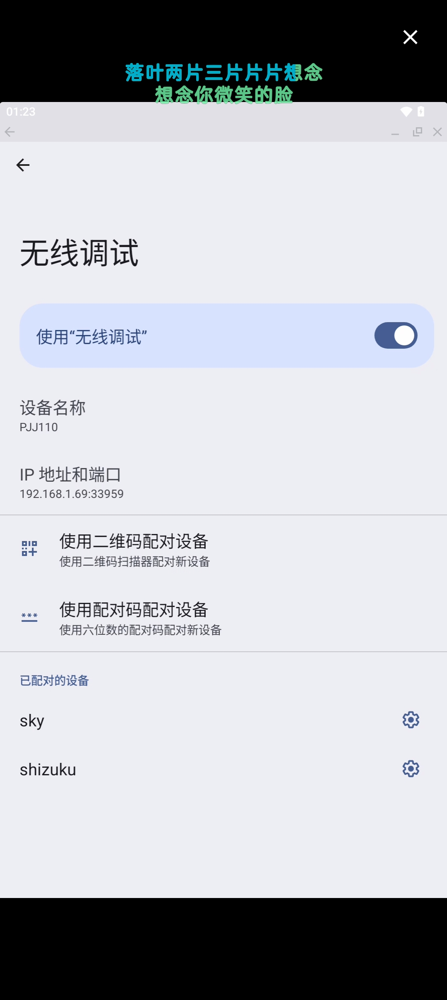
</p>

### 虚拟遥控器 / Remote

常用操作、方向键、音量与媒体控制，适合电视、盒子等无触控设备。

<p align="center">
  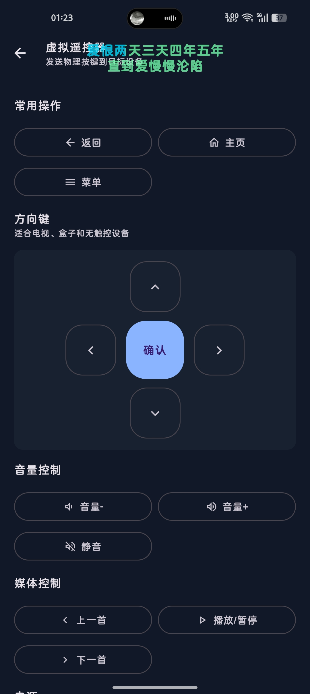
</p>

### 应用管理 / Apps

应用列表与搜索，支持启动 / 停止 / 启用 / 导出 / 卸载，以及冻结 / 解冻（列表标记状态）。

<p align="center">
  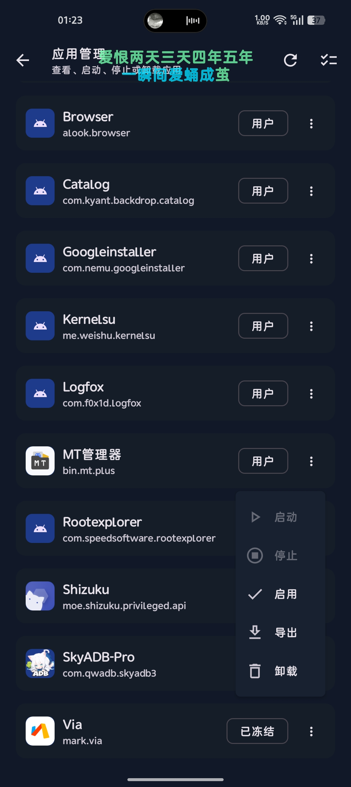
</p>

### 文件管理 / Files

浏览设备目录、上传、下载、新建、删除（含删除确认）；从设备拉取支持多选批量拉取到本机；存储空间按图片 / 视频 / 音频 / 文档 / 安装包 / 下载分类概览占用。

<p align="center">
  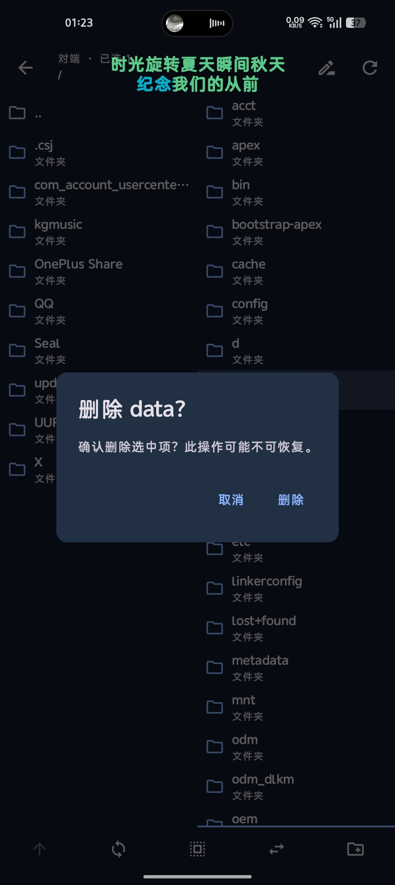
  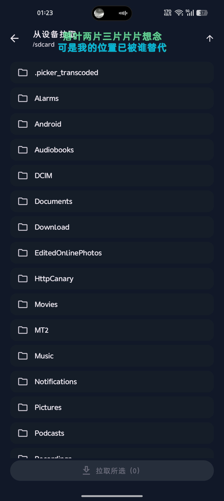
  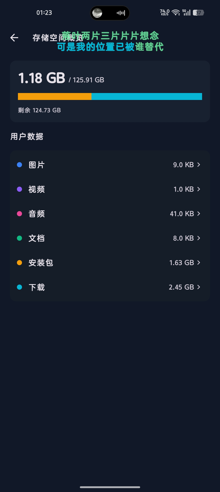
</p>

### 查看摄像头 / Camera

选择后置 / 前置摄像头并开始查看目标设备画面。

<p align="center">
  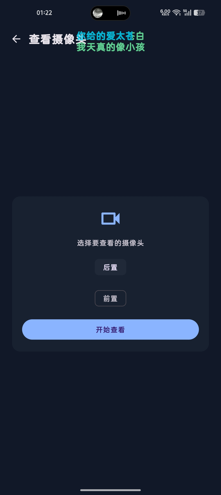
</p>

### 系统状态 / System Status

网络、电池、存储、CPU、内存、屏幕亮度、系统时间、当前运行应用与应用 / 系统进程列表实时监控。

<p align="center">
  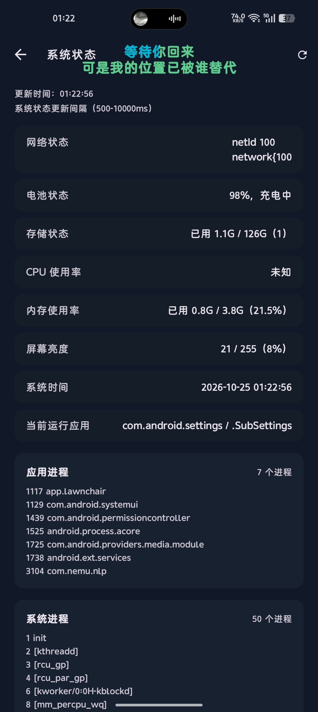
</p>

### Shell / Shell Command

执行 Shell 命令并查看输出与退出码，输出支持一键复制，命令支持收藏与历史记录。

<p align="center">
  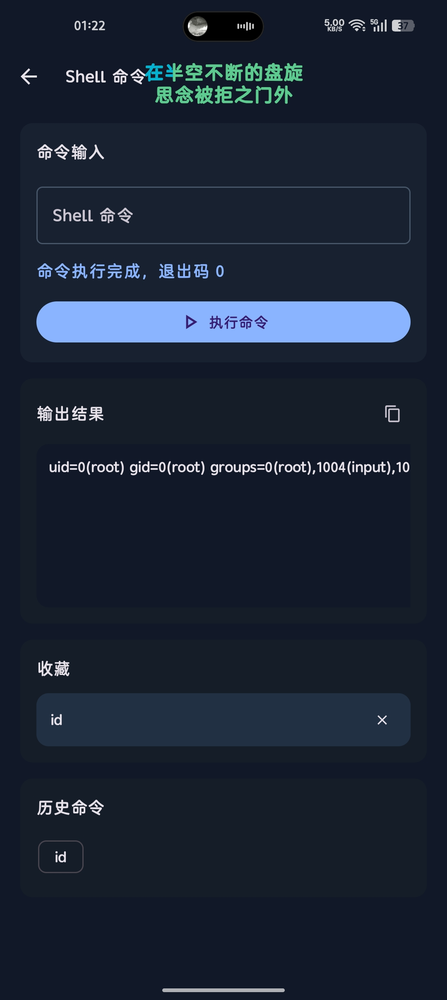
</p>

### 设置 / Settings

连接参数（默认端口 / 连接超时 / 命令超时 / 扫描网段）、镜像与摄像头画质（流畅 / 均衡 / 高清 / 自定义）、状态刷新间隔、主题模式、语言、检查更新、诊断日志、清理最近设备、项目地址与联系方式。

<p align="center">
  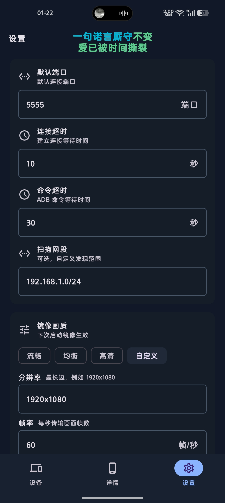
  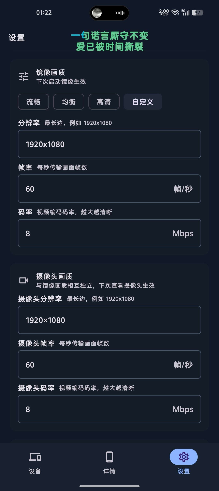
  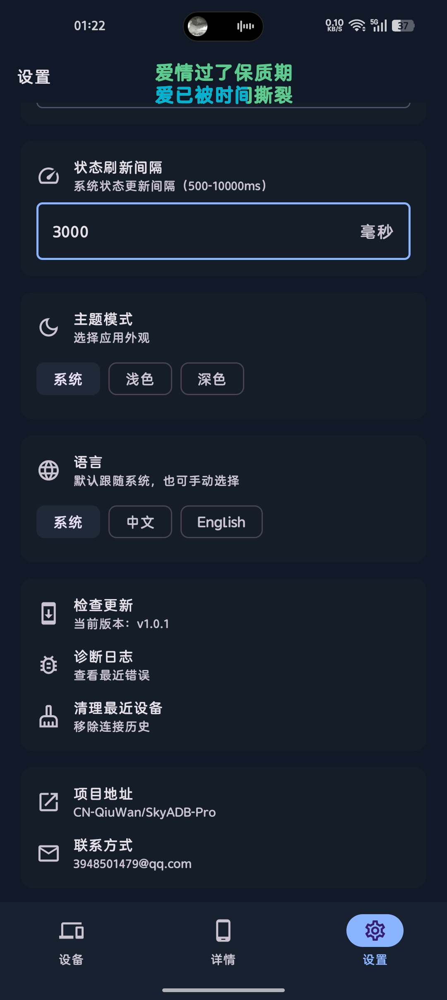
</p>

## 下载 / Download

- **SkyADB-Pro-1.0.1-release.apk**：可前往 Releases 页面获取最新版本。
- 安全校验码：
  SkyADB-Pro-1.0.1-release.apk
  SHA-256: f1389f838851df84e522b9395cfdbfceb0c42361a0508ce7346c93cc30f6c856

scrcpy-server-v4.1 (assets/scrcpy/)
SHA-256: deacb991ed2509715160ffdc7907e47b4160eb30d1566217e9047fd5b8850cae

## 如何使用 / Usage

1. 在目标设备开启开发者选项和无线调试（Android 11+ 推荐使用无线调试配对，也可直接扫码连接）。
2. 在 SkyADB-Pro 中输入目标设备 IP 和 ADB 端口，或使用无线调试配对 / 扫码连接 / 发现设备。
3. 连接成功后进入设备详情页，使用控制模式、观看模式、应用管理、APK 安装、文件管理、上传 / 拉取、截图、遥控器、屏幕镜像或 Shell 等功能。
4. 常用设备会自动保存到最近设备列表，后续可快速回填连接信息。

## 构建 / Build

```bash
# 使用 JDK 17+ 与 Android SDK
./gradlew assembleRelease
```

签名所需密钥通过环境变量注入，不会写入源码：

```bash
export SIGNING_STORE_FILE=/path/to/keystore.jks
export KEY_ALIAS=alias
export KEY_STORE_PASSWORD=password
export KEY_PASSWORD=password
./gradlew assembleRelease
```

## 技术栈 / Tech Stack

- Kotlin
- Jetpack Compose + Material 3
- Navigation Compose
- Lifecycle ViewModel + StateFlow
- Kotlin Coroutines / Flow
- DataStore Preferences
- Kadb 2.1.3
- scrcpy-server 4.1
- OkHttp 5.3.2 / Okio
- CameraX（扫码相机）
- ZXing（二维码解析）
- Timber
- JUnit

## 运行范围 / Runtime Scope

- 运行设备：最低 Android 7.0（API 24）。
- 编译目标：compileSdk 37，targetSdk 37。
- Android 17 局域网：需声明并运行时申请 `ACCESS_LOCAL_NETWORK`，用于 mDNS 发现、网段扫描和 WiFi ADB 连接。
- 被连接设备：以目标设备是否支持 ADB over TCP / Wireless Debugging 为准。

## 鸣谢 / Credits

- [Kadb](https://github.com/flyfishxu/Kadb)
- [scrcpy](https://github.com/Genymobile/scrcpy)
- [ZXing](https://github.com/zxing/zxing)

## 开源协议 / License

[](LICENSE)

本项目基于 [SkyADB](https://github.com/sky22333/skyadb) 进行优化改进，遵循 **GNU General Public License v3.0**（GPL-3.0）规范许可证发布。

- **SPDX 标识**：`GPL-3.0-only`
- **版权声明**：
  - Copyright (C) 2026 github.com/sky22333 (SkyADB)
  - Copyright (C) 2026 CN-QiuWan (SkyADB-Pro)
- **许可要点**：
  - 你可以自由使用、修改、分发本软件；
  - 分发时必须保留版权声明与本许可证全文；
  - 修改后的衍生作品必须以 GPL-3.0 相同的许可协议开源；
  - 本项目不提供任何担保。

完整许可条款见 [LICENSE](LICENSE) 文件。
